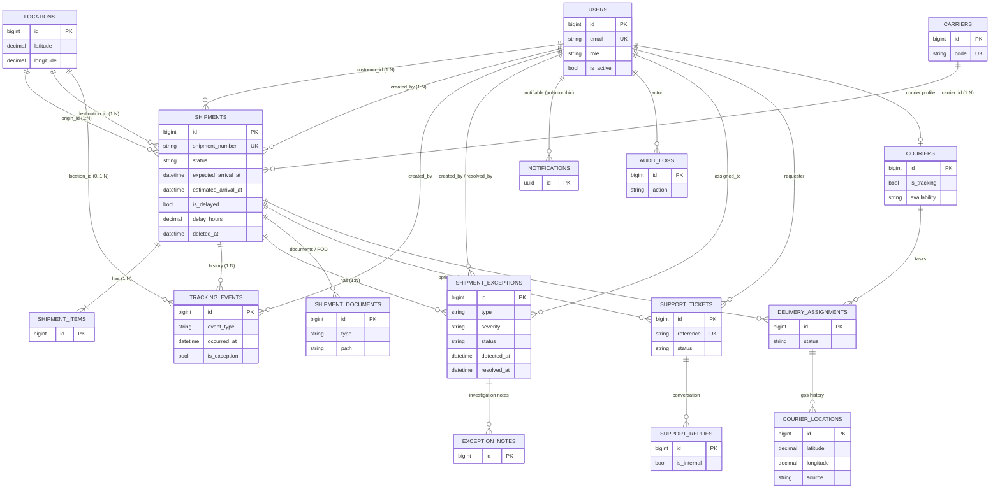

# Entity Relationship Diagram

## Design decisions

- **Shipment → tracking_events is hasMany** and append-only: history must never be overwritten, so the current state lives on `shipments.status` while the journey lives in events.
- **Shipment → exceptions is hasMany**: one shipment can face several disruptions (customs hold, then congestion).
- **Locations are shared master data** referenced by origin, destination and events; events also copy name/coordinates so history stays correct if a location is later edited.
- **Delay snapshot** (`is_delayed`, `delay_hours`, `delay_severity`) is denormalised on `shipments` for fast filtering and dashboards; `EtaService` is the only writer.
- **Soft deletes** only on `shipments` (financial/audit relevance); everything else is restricted or cascaded.
- Foreign keys: `restrictOnDelete` for master data, `nullOnDelete` for user attribution, `cascadeOnDelete` for child rows.
- Indexes: `(status,is_delayed)`, `(customer_id,status)`, `(shipment_id,occurred_at)`, `expected_arrival_at`, `(entity_type,entity_id)`.

- **Documents** live on the private disk; `path` is hidden from JSON and files are served only by an authorised controller.
- **Support replies** carry `is_internal` so staff notes never reach the customer.
- Roles are an enum column on `users` (no separate roles/permissions tables) — a deliberate simplification documented in the README.
- **courier_locations** is append-only GPS history (device timestamp `recorded_at`, server `created_at`, `source` = device|demo); indexed by assignment/shipment/courier and time.
- **delivery_assignments** keeps every attempt (re-assignments and failures stay as history); at most one active assignment per shipment is enforced in `DeliveryService`.
